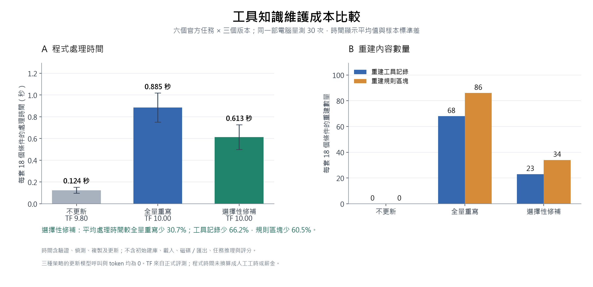

# 成员 3：正式实验与评测结果

日期：2026-10-30。完成六个官方任务（3、24、28、90、144、156）、三种策略、三个环境版本、三次全新重复，共 **162 个任务条件，162 条有效评分**。旧先导数据没有混入本轮。

## 实验设置

Agent 与 judge 均使用 `deepseek-v4-flash-ga-260731`。Agent temperature=0.2，最多 10 轮，每轮最多 4096 完成 token；judge temperature=0，每条一次，最多 16384 完成 token，使用 Agent 当时实际可见的工具返回。三种策略使用相同问题、参考标签、输入文件、推理与评分协议。

任务覆盖日志比较、报告写入、待办生成、时区转换、时间计算，以及卡片资料/图片与当日 LeetCode 查询。任务 90 的 `get_daily_challenge` 在 Late 被删除，实际替代接口为 `get_problem(daily=true)`；三版本发现与六次公开 API 探测均在该任务的模型执行前通过。

任务 24 原本使用的 `read_text_file` 保留不变，删除的是过时的 `read_file`，因此它作为保留与服务覆盖案例。早期说明误写过迁移方向，冻结元数据保留追踪，正确说明见 `member3_extension/migration-direction-correction.json`；问题、知识包和评分提示未因此修改。

三个批次分别使用独立工作目录与端口。后续条件有限并行以缩短等待，每个版本一个任务工作程序、最多四个同时评分请求；每批保留执行顺序修订记录。所有九个批次均经过条件审计和原始输入、提示、judge 回执哈希核对。

## 主要结果

| 策略 | 有效/预定 | TF 均值 ± 重复 SD | PE 均值 ± 重复 SD | ECS 均值 ± 重复 SD |
| --- | ---: | ---: | ---: | ---: |
| 不更新 | 54/54 | 9.80 ± 0.03 | 7.44 ± 0.17 | 9.51 ± 0.08 |
| 全量重写 | 54/54 | 10.00 ± 0.00 | 7.57 ± 0.03 | 10.00 ± 0.00 |
| 选择性修补 | 54/54 | 10.00 ± 0.00 | 8.02 ± 0.32 | 10.00 ± 0.00 |

SD 是三次重复均值的样本标准差，不是把不同任务或版本混在一起计算的离散程度。ECS 先对同一任务同一次重复计算三版本 TF 均值减总体标准差，再对预定任务与重复等权平均。缺失值不填零、不删案例；有预定条件未评分时，总体指标为 NA。

## 迁移案例：官方任务 90

| 策略 | Early TF（n=3） | Middle TF（n=3） | Late TF（n=3） |
| --- | ---: | ---: | ---: |
| 不更新 | 10.00 | 10.00 | 6.33 |
| 全量重写 | 10.00 | 10.00 | 10.00 |
| 选择性修补 | 10.00 | 10.00 | 10.00 |

不更新策略在 Late 继续请求旧的 `leetcode__get_daily_challenge`。保存的 MCP 日志明确返回 `Unknown tool: leetcode_1mcp_get_daily_challenge`，最终回答未能提供当日题目；这与单纯的进程异常或公网服务不可用不同。全量与选择性策略提供实际的新接口，实际效果由以上得分与原始轨迹共同核对。

工具错误不自动等于任务失败：部分待办案例先出现参数格式错误，随后恢复并完成。完整候选清单、得分、错误和路径见 `case-review.json`，供成员 5 继续分析。

## 更新成本

| 策略 | 更新 token | 重建工具记录 | 重建规则块 | 归档更新时间/秒 |
| --- | ---: | ---: | ---: | ---: |
| 不更新 | 0 | 0 | 0 | 0.000000 |
| 全量重写 | 0 | 68 | 86 | 1.722880 |
| 选择性修补 | 0 | 23 | 34 | 1.085716 |

成本按唯一 `adaptation.update_id` 去重，同一包重复使用不重复累计。原有三个任务复用归档知识包，表中对应时间来自那些包的原始生成记录；新增任务为本次生成。时间不含磁盘操作、共同初始化、任务推理与评分，且采样时系统负载不同，不能把该单次总时间换算成可靠的加速比例。重建记录数量比单次耗时更适合说明更新范围。

本次任务推理已记录 **2,656,870 token**，judge 所有尝试去重后已记录 **2,529,342 token**，合计 **5,186,212 token**；连线测试另计 94 token。记录到的 judge 请求共 175 次，其中 3 次没有完整用量回执。这些是已知用量，不是货币账单，未知用量不认定为零。

## 更新成本對比圖與重複量測

本節可用於作業 4.3 Update Cost。提供的報告範本允許以 token、時間或 API 費用作成本指標，並要求標明單位與統計範圍。

| 策略 | 程式處理時間（秒，平均 ± SD） | 更新 token | 重建工具記錄 | 重建規則區塊 | TF |
| --- | ---: | ---: | ---: | ---: | ---: |
| 不更新 | 0.1244 ± 0.0277 | 0 | 0 | 0 | 9.80 |
| 全量重寫 | 0.8849 ± 0.1335 | 0 | 68 | 86 | 10.00 |
| 選擇性修補 | 0.6130 ± 0.1140 | 0 | 23 | 34 | 10.00 |

**口徑：** 每次處理六任務 × 三版本共 18 個知識條件；30 次離線重複、一次暖機，策略與條件順序按固定種子交錯。時間包含整個 `adapt()` 呼叫的校驗、偵測、複製、生成、保留檢查及最終完整性檢查，不含載入、共同初始化、磁碟讀寫、匯出、模型任務執行與評分。不更新的數值是校驗／複製等共同處理開銷，其改寫成本仍為 0。誤差線為 30 次的樣本標準差。TF 為原正式實驗的三次重複結果，不是新增模型任務。

**成本與效果：** 在相同電腦、相同六任務知識與相同處理範圍下重複量測 30 次，選擇性修補的平均處理時間為 0.6130 秒，全量重寫為 0.8849 秒，前者平均少 30.7%。兩者正式任務完成度皆為 10 分。這支持本機此實作的處理時間優勢與較小重建範圍；未量測人工工時或薪金。

工具記錄從 68 減至 23，減少 66.2%；規則區塊從 86 減至 34，減少 60.5%。數量衡量重建工作範圍，不能直接換算成員工工時。三種策略的更新階段都沒有模型 API 呼叫，更新 token 與更新 API 費用皆為 0，因此此實驗沒有觀察到更新 API 費用差額。

**資料定位：** `benchmark.json` 保存 90 條策略／重複彙總、來源與程式雜湊、測量範圍；每條彙總包含 18 次相同輸入處理。所有生成結果均核對為與凍結知識相同。這是正式任務評測以外的離線成本微基準，沒有改寫原始 162 條評分或原有單次時間紀錄。

## 评分异常与使用范围

有效低分未重评。技术缺失最多额外请求两次，模型、提示、token 上限和评分协议不变；每次回执都保留在新目录。缺少最后一个 JSON 大括号且所有原始分数与理由完整的回覆可离线恢复，原文保持不变，不产生额外模型调用。

全量与选择性修补在 18/18 组对应条件下提供相同的模型可见工具与使用说明。因此，两者的小幅得分差异不能直接解释为更新算法优劣；本实验支持的是实际工具迁移与更新范围/保留能力的观察。没有制造“更新过度”损伤案例，也没有将随机参数错误当作此类证据。

三个官方时钟快照的 `get_current_time` locale/timestamp 接口已实测约快一小时，而结构化 `get_time_info` 正常；相关任务评分应结合此服务缺陷理解。judge 与 Agent 使用同一模型，任务仅为 201 个官方选定任务中的六个，重复数为三，后续并行顺序也增加执行条件差异；结果不能外推至全基准。

## 交付与验证

- `member3/evidence/formal/results.json`：162 条条件、评分、重复统计、成本、用量与来源。
- `member3/evidence/formal/report.md`：逐条件结果表。
- `member3/evidence/formal/case-review.json`：真实轨迹的失败/恢复候选，含路由错误证据。
- 原有 85 项测试、新增 13 项统计测试、3 项离线恢复测试通过；工具检查为原有 27 条、扩充 6 条、迁移 3 条，另有时钟 9 次与公开 API 6 次实测。

## 约两分钟汇报稿

我负责把三种知识更新策略接到统一的实验与评分流程。这次我们使用六个官方任务，在 Early、Middle、Late 三个环境分别比较不更新、全量重写与选择性修补，每个条件做三次全新重复，总共 162 次任务，并保留原始答案、工具轨迹与评分回执。

评测输出任务完成度 TF、规划效率 PE、跨版本 ECS，以及知识更新成本。平均分和波动来自预先固定的完整任务集合，技术缺失不填成零分，历史先导数据也没有混入。结果表给出了三种策略的均值与重复间波动。

总体 TF 不更新为 9.80，全量与选择性均为 10.00；ECS 分别为 9.51、10.00 和 10.00。选择性修补重建 23 条工具记录，全量重写为 68 条。

任务 90 提供了真实迁移案例：后期版本删除每日挑战旧接口，改由新接口的 daily 参数提供。不更新策略仍调用旧名称，日志能定位到未知工具错误；更新后的知识则包含新接口。任务 24 用于观察保留能力，它本来使用的读档接口没有被删除。

全量与选择性修补在本轮对应条件下提供相同知识，差别主要在重建范围，因此不把随机分数差异解释成方法优势。我们还记录了时钟服务本身的一小时偏差，并把它与更新失败分开。报告中的成本按知识包去重，结果和案例均可从保存的原始证据复核。
